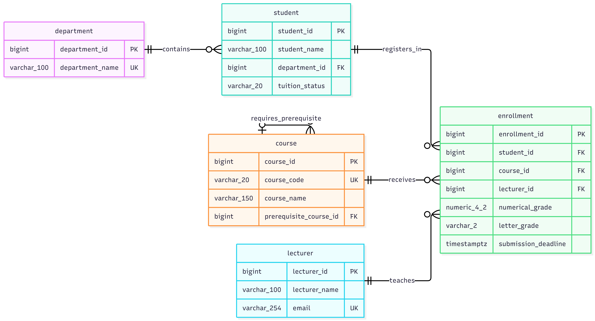

# Student Result Portal Database Design ER Diagram

## Understanding the Diagram

- PK (Primary Key) uniquely identifies each record in a table, while FK (Foreign Key) links one table to another. UK (Unique Key) ensures that a value is unique.
- Relationship symbols : || means exactly one, |o means zero or one, and o{ means zero or many.
- A department can have zero or multiple students. Each student belongs to one department.
- A course can have zero or one prerequisite course. A course can be a prerequisite for zero or multiple courses.
- A student can have zero or multiple course enrollments. Each enrollment belongs to one student.
- A course can have zero or multiple enrollments over time. Each enrollment refers to one course.
- A lecturer can teach zero or multiple course enrollments. Each enrollment has one primary lecturer.
- All fields are required except prerequisite_course_id, numerical_grade, and letter_grade.